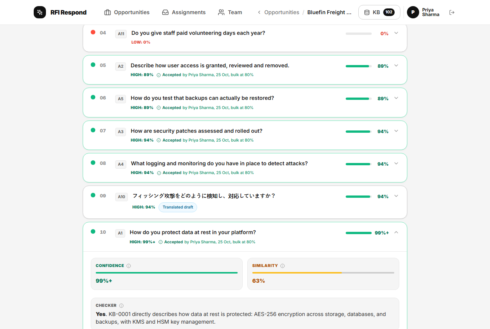
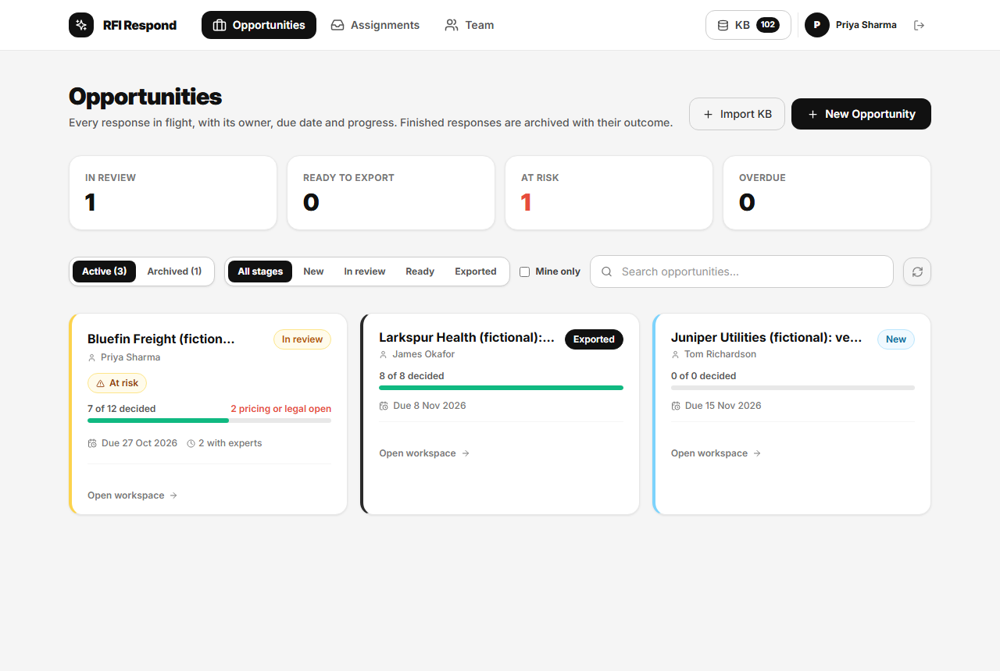
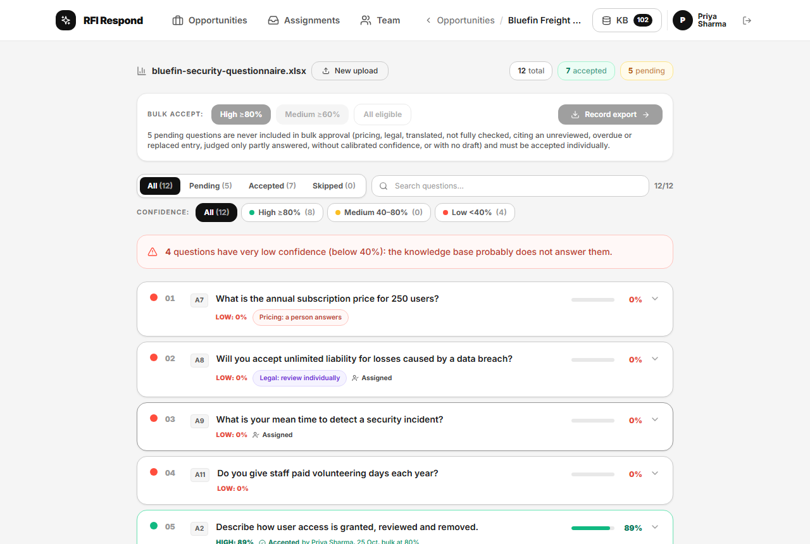
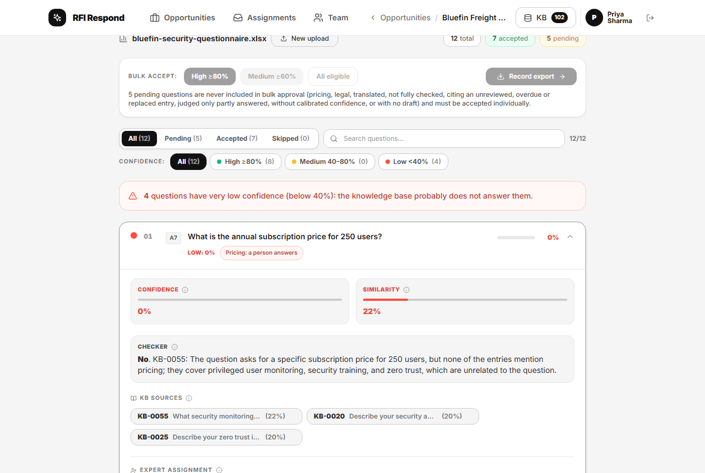
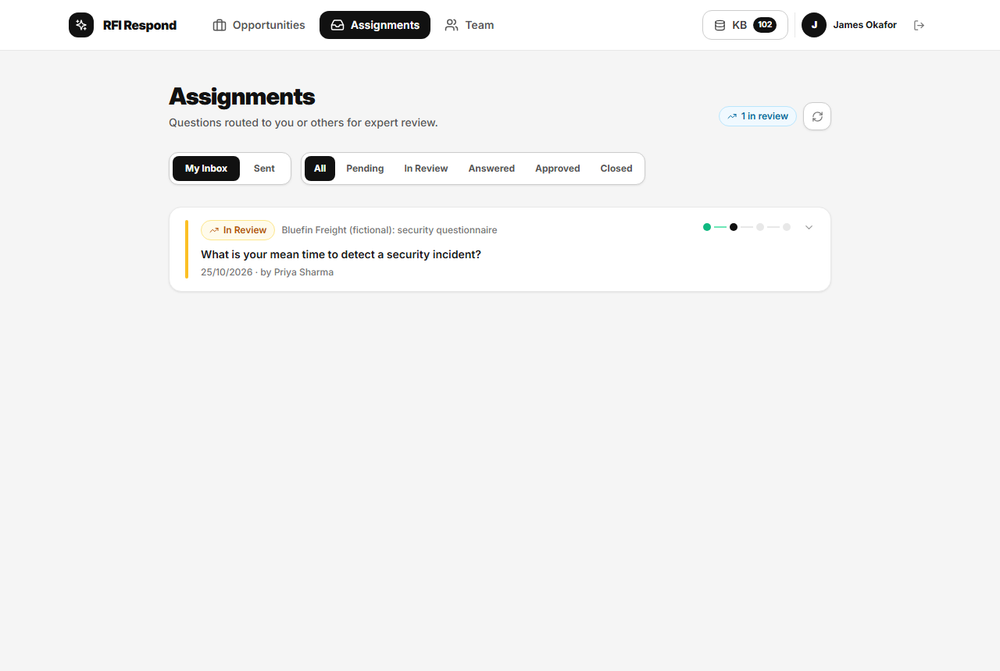
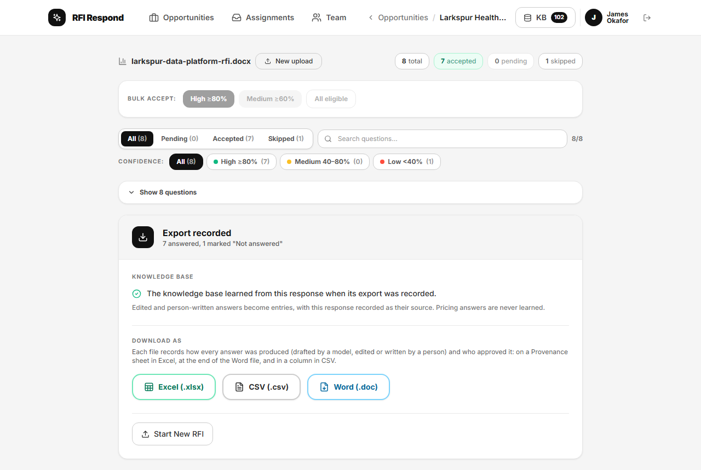
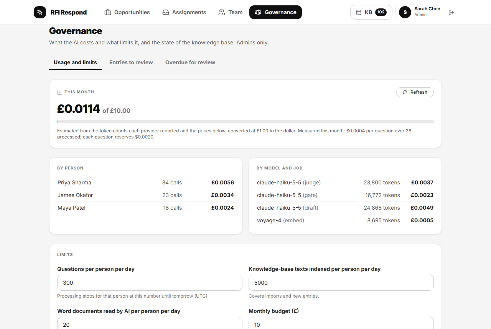

# RFI Respond

An internal tool that helps an organisation answer requests for information (RFIs), requests for quotation (RFQs) and security questionnaires. It drafts each answer from the organisation's own knowledge base, says how confident it is and why, holds pricing and legal questions for a person, routes specialist questions to colleagues, and adds what people wrote to the knowledge base when each response is exported.

Product owner: Rory McClelland. Code written by Claude, as an AI coding agent, with every change read and questioned by the product owner. Rebuilt from a prototype in eight sprints (Sprints 0 to 7). Synthetic data only; runs locally.



## What it does

- **Reads the questions** from a spreadsheet or a Word questionnaire. Files are opened in the browser with size and decompression limits. For a Word document the text is then sent to the server, where Claude finds the questions; each is kept only if it appears in the document word for word, with the customer's own numbering, and a person checks the list before anything is saved.
- **Drafts each answer from the knowledge base**, on the server. The question is matched by meaning (voyage-4 embeddings, or a local model); Claude Haiku 5.5 checks whether the matched entries actually answer it, then drafts only from those entries and cites them. Code rejects a draft that cites an entry it was not given, or contains a figure, link or email address not in its sources; the question is then left without a draft, with a note saying why, for a person to answer. When nothing answers the question, or it asks for a price, there is no draft.
- **Says how confident it is, and why.** Confidence is calibrated on an evaluation set: the measured chance that the knowledge base answers the question. The card shows the checker's verdict and its one-sentence reason.
- **Lets the owner approve in bulk, within limits the database enforces.** A question qualifies only if it was processed on the server, has a draft, has calibrated confidence at or above the chosen threshold, and the checker said "yes" (or, in a set-up with no checker configured, its confidence comes from similarity alone). Pricing, legal and translated questions, questions whose checks could not run, and drafts citing an entry that is unreviewed, overdue for review or replaced, are always decided by a person. Every approval records who, when and how.
- **Routes specialist questions** to colleagues, suggesting who from stated expertise and who wrote or approved similar answers, with an inbox for each.
- **Learns from each exported response.** Recording the export turns edited and person-written answers into knowledge-base entries linked to the response they came from. A member's addition, or an answer that would replace an existing entry, waits for an admin's review; pricing answers are never learned; entries fall due for review after 12 months.
- **Exports** to Excel, CSV and Word, each file recording how every answer was produced (drafted by a model, edited or written by a person) and who approved it.
- **Caps spend.** Every AI call is recorded and priced. Processing stops for a person who reaches the daily limit, and for everyone when the month's estimated spend reaches the budget.

## What it does not do

- **It is not a hosted product.** It runs on a local PC against a local Supabase stack. A hosted deployment would need the steps in [`docs/DEPLOYING.md`](docs/DEPLOYING.md) first.
- **Its figures come from small synthetic sets** (363 questions written by Claude, unreviewed by anyone outside the project). Read them as estimates: [`docs/evals/README.md`](docs/evals/README.md).
- **The checker is not perfectly consistent.** Asked again, it changed its verdict for 7.2% of test questions, mostly between "yes" and "partly".
- **Japanese questions** get Japanese drafts, labelled as translations and always reviewed individually. A knowledge base that works across languages is on the backlog, not built.
- **It is not a compliance product.** The [governance pack](docs/governance/) maps the controls to the EU AI Act and the NIST AI Risk Management Framework, but makes no claim of compliance.
- **No PDF or pasted-email input yet**, and users are invited through the Supabase dashboard, not the app.

## Screenshots

| | |
|---|---|
|  |  |
| Responses in flight, with owner, due date and progress | Review, lowest confidence first; bulk approval above a threshold |
|  |  |
| A pricing question, never drafted or bulk-approved | A specialist's inbox of assigned questions |
|  |  |
| An exported response, and what the knowledge base learned | Spend, limits and prices on the governance page |

All screenshots show the synthetic demo data in `supabase/seed.sql`.

## How it was built

The starting point was a prototype generated with Bolt.new: the first commit in this repository. Reviewed line by line, it matched by keywords, assembled drafts from templates, and part of its confidence score was a random number. It has been rebuilt sprint by sprint:

| Sprint | What it delivered |
|---|---|
| 0 | Clean-up: access control in the database, tests, CI, honest copy |
| 1 | Matching by meaning and calibrated confidence |
| 2 | Grounded drafting, the answerability check, pricing and legal gates, server-side processing |
| 3 | Workflow and the learning loop |
| 4 | Cost controls, entry review and the governance pack |
| 5 | Word questionnaires |
| 6 | Checker reliability |
| 7 | Documentation, demo data and publishing |

Each sprint followed the same cycle:

1. **Refine** the stories into test cases, risks and questions for the product owner, recorded in [`docs/refinement/`](docs/refinement/) with the answers.
2. **Build test-first**, one commit per story.
3. **Review:** a separate AI agent that had not seen the reasoning reviewed every sprint's changes for security and correctness. There was no human security review. Every finding was fixed with a test before the sprint closed (listed at the end of each refinement).
4. **Check end to end** in a browser on the local PC, against the agreed test cases.
5. **Close:** anything undelivered goes back to the [backlog](docs/BACKLOG.md), anything raised at the review and not fixed becomes a backlog row, the [risk register](docs/governance/RISK-REGISTER.md) is updated and the backlog re-ranked.

The product brief is [`docs/PRODUCT.md`](docs/PRODUCT.md), the original requirements are the 65 job stories in [`docs/JOB_STORIES.md`](docs/JOB_STORIES.md), and the reasoning behind the main choices is in [`docs/decisions/`](docs/decisions/). How the parts fit together, and where the trust boundaries are: [`docs/ARCHITECTURE.md`](docs/ARCHITECTURE.md).

## Running it locally

Needs Node 22, npm 11 (`npm install -g npm@11`) and Docker (for the local Supabase stack). Processing new questions needs an Anthropic API key and, for hosted embeddings, a Voyage AI key. Without them the app still runs and shows the demo data, whose drafts were recorded from a real run of the pipeline (`npm run demo:record`), so they are saved outputs, not live ones; the Edge Functions and their `.env` are only needed to process new questions.

```bash
npm ci
npm run db:start                     # starts Supabase locally; prints the API URL and anon key
cp .env.example .env                 # paste the API URL and anon key into .env
cp supabase/functions/.env.example supabase/functions/.env   # API keys, server side only
npm run db:reset                     # applies the migrations and loads the synthetic seed
npx supabase functions serve         # the Edge Functions, in a second window
npm run dev                          # http://127.0.0.1:5173
```

Sign in as any seeded user (for example `sarah.chen@example.com`, the admin, or `priya.sharma@example.com`, who owns a response in review) with the local development password in `supabase/seed.sql`. The seed loads 100 synthetic knowledge-base entries and four fictional responses, one at each stage.

## Scripts

| Script | What it does |
|---|---|
| `npm run dev` / `build` | Development server; production build |
| `npm run typecheck` / `lint` | TypeScript; ESLint |
| `npm test` / `coverage` | Unit tests (app, server pipeline, evaluations, documentation) |
| `npm run test:db` | Database tests; needs `DB_TEST_URL` (a Postgres superuser connection) |
| `npm run db:start` / `db:stop` / `db:reset` | Local Supabase stack |
| `npm run eval:*` | The evaluations ([`docs/evals/README.md`](docs/evals/README.md)); need API keys |
| `npm run demo:record` / `demo:seed` | Record the demo drafts from a real run; regenerate the seed |
| `npm run screenshots` | The screenshots above, and a layout check at 768 px |

## Tests

- **Unit tests:** file reading and hostile input, the server pipeline (matching, checker, gates, drafting checks, extraction, calibration, usage), exports, the evaluation maths, and the documentation itself (figures against their reports, links, spelling).
- **Database tests** (`supabase/tests/db/`): every row of the role matrix (who may read or change what, by role: [decision 0003](docs/decisions/0003-access-control.md)), run as real users against row-level security; approvals, learning, review and caps; the seed. They run on plain Postgres with a small Supabase shim ([decision 0004](docs/decisions/0004-local-first-and-testing.md)).
- **CI** runs both, audits production dependencies, searches the built bundle for keys, builds, and applies every migration and the seed to the real Supabase stack.

## Project rules

1. **Honesty.** Nothing claims more than the code does.
2. **Synthetic data only.** See [`sample-data/`](sample-data/).
3. **Secrets stay server-side.** Only the public Supabase anon key is in the browser; row-level security holds with it in an attacker's hands.
4. **Human in the loop.** Every answer that leaves has a named human decision behind it.
5. **Least privilege**, enforced by the database ([decision 0003](docs/decisions/0003-access-control.md)).
6. **Uploads are untrusted** ([decision 0002](docs/decisions/0002-spreadsheets-and-dependencies.md)).
7. **The knowledge base only learns with provenance.**

## Licence

No licence is granted. The code is published to be read; all rights are reserved, so it may not be reused without permission. (GitHub's terms still let anyone view and fork a public repository.)
