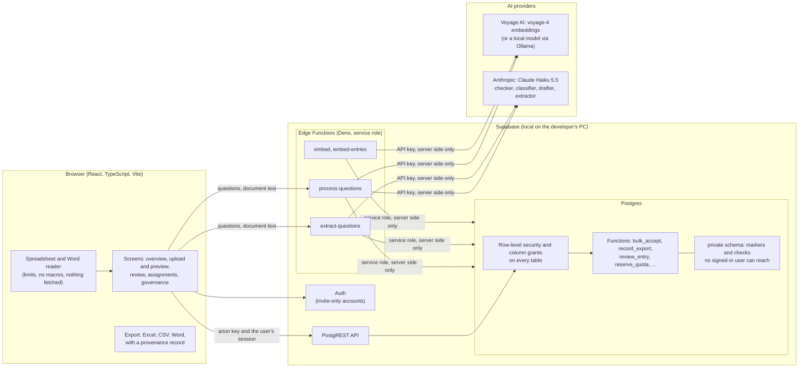

# Architecture

How RFI Respond is put together, where the trust boundaries are, and what happens to one question from upload to export. The decisions behind it are in [`docs/decisions/`](decisions/); the controls and their tests are listed in the [risk register](governance/RISK-REGISTER.md).

## The parts



**Trust boundaries.**

- **The browser holds only the public anon key and the user's session.** Every rule on who may read or change what is enforced in the database (row-level security, column grants, and functions that check the caller), so the rules hold even if someone calls the API directly with the anon key ([decision 0003](decisions/0003-access-control.md)). The app refuses to start with a service-role or secret key, and CI searches the built bundle for keys (risk R-06 in the [risk register](governance/RISK-REGISTER.md)).
- **Provider keys exist only in the Edge Functions** ([decision 0005](decisions/0005-where-the-ai-runs.md)). The browser never calls a model.
- **Uploads, knowledge-base text and model output are all untrusted.** Files are read with size and decompression limits; text sent to a model is passed as data, never as instructions; model output is checked in code before anyone sees it.
- **What is assumed:** members reach the database only through the API. A direct database connection would let its holder set their own identity, so direct connections are for administrators only (decision 0003).

## One question, from upload to export

```mermaid
sequenceDiagram
  autonumber
  actor Owner as Response owner
  participant App as Browser
  participant DB as Postgres
  participant Fn as Edge Functions
  participant AI as Providers

  Owner->>App: Upload a spreadsheet or Word file
  App->>App: Open the file (size and decompression limits)
  App->>Fn: Word only: send the text; extract-questions finds the questions, keeping only those found word for word
  Owner->>App: Check the list in the preview
  App->>DB: Save the questions (text only)
  App->>Fn: Process in batches of ten
  Fn->>DB: Reserve against the daily cap and monthly budget
  Fn->>AI: Embed the question, match the knowledge base
  Fn->>AI: Do the entries answer it? (checker), Is it pricing or legal? (classifier)
  alt Pricing, or nothing answers it
    Fn->>Fn: No draft: held for a person
  else
    Fn->>AI: Draft from the matched entries only
    Fn->>Fn: Reject a draft citing an entry it was not given, or a figure, link or email not in its sources (no draft, with a note)
  end
  Fn->>DB: Save draft, calibrated confidence, gate, verdict and reason, models and prompt versions; record usage
  Owner->>App: Review, lowest confidence first
  Owner->>DB: Bulk-approve above a threshold (bulk_accept: never gated, uncalibrated or "partly" questions)
  Owner->>DB: Accept, edit, skip or assign the rest
  Owner->>DB: Record the export (record_export)
  DB->>DB: Learn: edited and person-written answers become entries with provenance; members' replacements wait for an admin's review
  Owner->>App: Download Excel, CSV or Word, each with a provenance record per answer
```

**What decides whether a question can be approved in bulk.** All of these, checked by the database at the moment of approval: processed on the server; calibrated confidence at or above the threshold; a draft to approve; the checker's verdict "yes" (or no checker configured); no gate (pricing; legal; translation; unchecked, meaning the classifier or the review check could not run; or citing an entry that is unreviewed, overdue for review or replaced). Everything else is decided by a person, one question at a time, and every decision is recorded with who, when and how.

## Where things are

| Path | What it holds |
|---|---|
| `src/` | The React app. `src/lib/` holds the logic with unit tests: file reading (`spreadsheet.ts`, `wordDocument.ts`), formatting, usage, sessions |
| `supabase/functions/_shared/` | The server-side pipeline shared by the Edge Functions and the evaluations: matching, checker, gates, drafting, extraction, calibration, usage |
| `supabase/functions/*/index.ts` | The Edge Functions: authentication, caps, then the shared pipeline |
| `supabase/migrations/` | The schema and every access rule, in order. No data |
| `supabase/seed.sql` | Synthetic users, knowledge base and demo responses, for local development only |
| `supabase/tests/db/` | Database tests for every row of the role matrix, run against Postgres with a Supabase shim |
| `eval/` | The evaluation scripts and synthetic sets; reports in `docs/evals/` |
| `docs/` | Product brief, backlog, sprint refinements and reviews, decisions, governance pack, evaluation reports |
