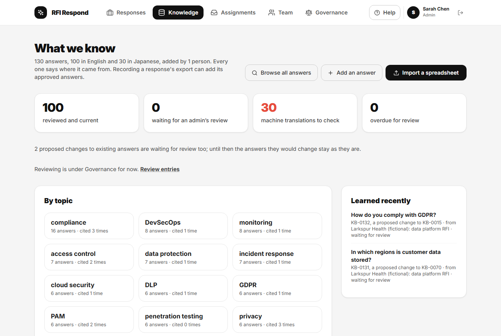
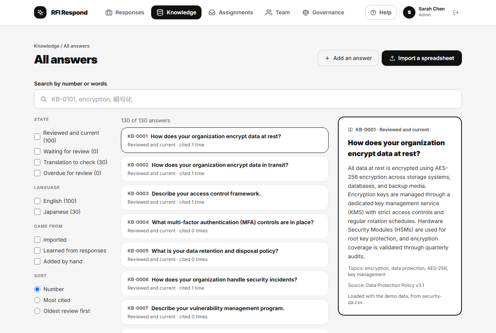
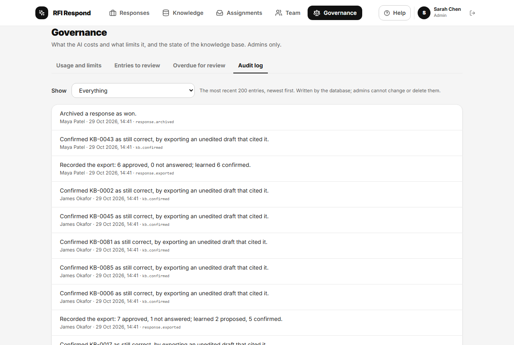

# Administering RFI Respond

For admins: the people who look after RFI Respond for their organisation. An admin can do everything a response owner can, on every response ([Running a response](running-a-response.md)), and the things on this page.

## People

### Inviting someone

Accounts are by invitation only. On the **Team** page, under **Invite someone**, give the person's email address and, if you like, their name, and choose **Send invitation**. They get an email from the installation's mail settings with a link to the app, which asks them to choose a password. Everyone invited joins as a member; make them an admin afterwards if they need it (below). Each admin can send 20 invitations a day. An address that already has an account, even one not yet approved, is refused and nothing is sent: resend an invitation from Supabase instead. Addresses on reserved domains that cannot receive mail (such as `.invalid`, used by the demo's fictional people) are refused too. Each invitation is recorded in the audit log; if that record cannot be written, the message after sending says so.

Supabase's dashboard (Studio) can still invite people, under Authentication, then Users, and is where an invitation is resent or withdrawn. On a local install Studio is at the address `npx supabase start` prints (usually `http://127.0.0.1:54323`); the invitation email itself is caught by the local mail viewer (usually `http://127.0.0.1:54324`).

### Roles and profiles

Under **Team**, choose **Edit** on anyone's card to change their name, job title, department and expertise tags. **Admin Access** gives or removes admin rights; you cannot change your own, so there is always at least one admin. Every change of admin rights is recorded in the audit log.

## The knowledge base

Drafts are written only from the knowledge base, so its quality is the quality of the answers. **Knowledge** in the top bar opens it as a page of its own (Sprint 17), for everyone, not only admins.

- **What we know**, the overview: how many answers there are, in which languages and added by how many people; four counts that open the matching answers (**reviewed and current**, **waiting for an admin’s review**, **machine translations to check**, **overdue for review**); the answers **By topic**, from their tags, with how often each topic was cited in responses; and what was **Learned recently** from responses. A proposed change to an existing answer (learned from a response) is not counted as an answer of its own: it waits for review, and the answer it would change stays as it is until then.
- **Browse all answers**: search by entry number (`KB-0101`, or just `101`) or by the words of questions, answers and tags; filter by state, language and where an answer came from (**Imported**, **Learned from responses**, **Added by hand**); and sort by number, most cited or oldest review first. Retired answers are left out unless you tick **Retired**. Searching by meaning is what **Ask it a question** does (below). An entry written in Japanese is marked **Japanese**; the app works out an entry's language from its text, so there is nothing to choose.
- **Add an answer** adds one question and answer, with tags and a source. An admin's entry counts as reviewed at once; a member's waits for review (below).
- **Import a spreadsheet** adds many at once from a spreadsheet (.xlsx or .csv) with a question column and an answer column, and optionally tags and source. Map the columns, choose **Preview Import** to check the rows, untick any you do not want, then import. Rows without a question or answer are left out, and so is any question already in the knowledge base in the same language (ignoring case and spacing): an English question imported with a Japanese answer is a new, Japanese entry.

### One answer and its history

The answer you choose opens its own page beside the list (on a phone, in place of the list, with **Back to the list**). It shows the answer, its state, topics and source and its **Next review**, and then:

- **A proposed change is waiting**, when a response proposed a different answer to the same question and an admin has not yet looked at it.
- **Where it has been used**: each response whose draft cited it, the question, whether the answer was approved as drafted, approved after editing, not answered or still to do, and how the response stands (in progress, exported, won, lost, withdrawn or archived).
- **History**, oldest first: how it was added, imported or learned; each review, with the earlier text when it was corrected; changes of topics or source; each confirmation by use (an export that approved it unedited); retirement and restoring; and what it replaced.
- **Other languages**: the translations made from it, or the entries it was translated from.

Everyone sees the same page, history included; the rest of the audit log stays with admins. An admin can also, on the page:

- **Approve** an answer waiting for review, or **Mark as still correct** one already reviewed, which moves its next review on by the review interval.
- **Edit** its question, answer, topics or source. Changing the question or answer counts as your review; topics and source change without one.
- **Approve the change** or **Decline the change**, for a proposed change.
- **Retire** an answer that is no longer true (a lapsed certificate, a closed office), saying why in 5 to 500 characters. A retired answer is no longer matched, drafted from or learned onto, its question is free for a new answer, and any draft still to do that cites it is held for a person. It stays readable, marked **Retired**, with its reason and history. **Restore** brings it back, unless another answer now has its question. Declining a proposed change retires it in the same way, and leaves the answer it would have changed as it is. Both are recorded in the audit log.

**Governance** (below) still lists everything waiting for review in one queue.

### Asking it a question

**Ask it a question**, on the knowledge page, takes a question as a customer would write it and shows the answer the knowledge base would draft, before any questionnaire arrives: the draft, its confidence, the checker's verdict and reason, what would happen to it in a response (a pricing question, for instance, is never drafted), and the answers it drew on, each opening its page. It uses exactly the matching, checks and drafting of a response, so it counts towards your daily question limit and the month's budget. Nothing is saved but its cost.

New entries are indexed for meaning-based search straight away. If indexing fails (a provider problem, or your daily indexing limit), the app says so. Entries without an index are indexed before questions are next matched, as far as the person's limit allows; a question matched while some are still missing says so and is not approved in bulk.

Entries are also learned from responses when their export is recorded ([Running a response](running-a-response.md#what-the-knowledge-base-learns)).

## Governance

**Governance** has four tabs; the fourth, the audit log, is described [below](#the-audit-log). Where a demo is loaded (the hosted demo), a fifth, **Demo**, resets it ([below](#resetting-the-demo)).

### Usage and limits

- **This month**: the estimated spend on AI so far against the monthly budget, from the token counts each provider reported and the prices listed below. A warning appears for admins from the warning point, and for everyone when the budget is reached.
- **By person** and **By model and job**: who used what.
- **Limits**: the caps the database enforces. Change them and choose **Save limits**; every change is recorded in the audit log.
  - Questions per person per day; knowledge-base texts indexed per person per day; Word documents read by AI per person per day. Each person's count resets at midnight UTC.
  - The monthly budget, and the share of it at which admins are warned. When the month's estimated spend reaches the budget, processing stops for everyone until the next month or until the budget is raised.
  - How much each question, each knowledge-base text indexed, and each 1,000 characters of a Word document, reserves against the budget while it is processed (compare it with the measured average shown above).
  - The exchange rate from US dollars, which providers price in.
  - How often knowledge-base entries fall due for review (in months).
- **Prices**: the price per million tokens for each model, with the date it was checked. Local models cost nothing. If a call used a model with no price, **This month** names the model and says the figure is too low until its price is added. Set spending limits in the providers' own consoles as well.

### Entries to review

Entries added by members, imported by members, learned from an answer a member approved, or learned from a translated draft (whoever approved it), wait here. A translation says which entries it was translated from and from which language; check the translation itself, not only the facts. They are in the knowledge base already, but a draft that cites one is never approved in bulk until an admin reviews it.

For each entry choose **Approve**, or **Correct** to fix the question or answer first and then **Save corrections and approve**. If approving it would replace an existing entry, the card shows the entry it replaces and what that entry says now. Approving releases the questions waiting on it in open responses, unless they also cite another entry still waiting.

### Overdue for review

Entries not reviewed or confirmed within the review interval. A draft that cites one is never approved in bulk until it is reviewed again. Each card shows the date it fell due and, if it was cited in the last 90 days, how often. Choose **Still correct**, or **Correct** it. An answer approved unedited at export also counts as a confirmation of the entries it cited.

## Deleting a response

Archive finished responses rather than deleting them: an archived response is the record of what was sent. Only a response created in error should be deleted. On its card on the overview, choose the bin icon (**Delete a response created in error**), give a reason of at least ten characters, and choose **Delete permanently**. It removes the response, its files and questions, and records the deletion and your reason in the audit log. It cannot be undone.

## Resetting the demo

Only where the demo data was loaded, as on the hosted demo. Under **Governance**, **Demo**, type the whole phrase `reset the demo` in small letters, and choose **Reset the demo**; the button stays unavailable, and the line under the box says what is missing, until the phrase matches. It removes every response and knowledge-base entry, including anything reviewers added, and loads the demo again, with entry numbers from KB-0001. Real people's accounts and roles, the limits, real people's usage and the audit log are kept, and the reset itself is recorded in the audit log; the demo's fictional people are put back as they were loaded. Older audit entries that name an entry number (KB-0042, say) refer to the entry that had that number before the reset. Do not reset while someone is processing questions: their run would fail and need starting again. The next sign-in indexes the entries again (a few pence). A local install or a real deployment without the demo has no **Demo** tab.

## The audit log

Exports (and exports recorded again), changes after an export, archives, deletions, knowledge-base reviews, questions held and released, direct changes to knowledge-base entries, settings, prices, admin changes, invitations and demo resets are recorded by the database in its audit log, which only admins can read and which admins cannot change or delete. Read it under **Governance**, **Audit log**: the most recent 200 entries, newest first, each saying in plain words what happened, who did it and when. **Show** narrows it to one kind.

