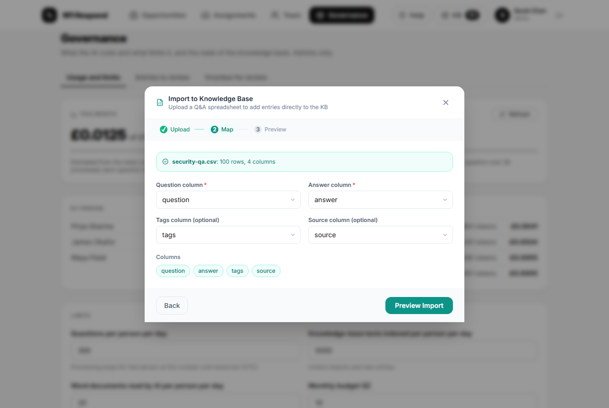
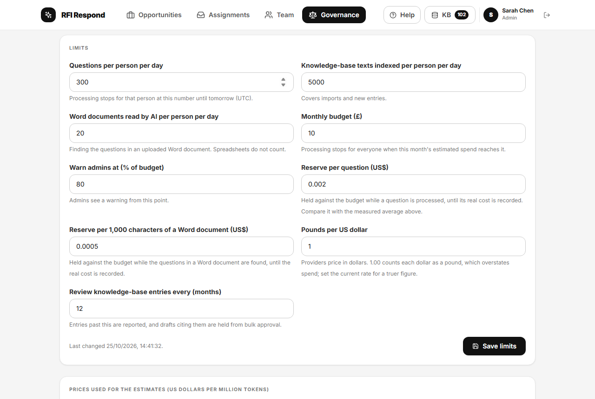
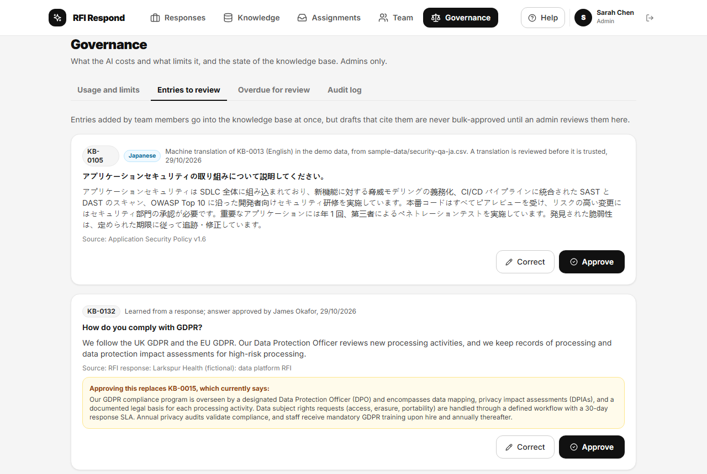

# Administering RFI Respond

For admins: the people who look after the workspace. An admin can do everything a response owner can, on every response ([Running a response](running-a-response.md)), and the things on this page.

## People

### Inviting someone

Accounts are by invitation only, and invitations are sent from Supabase, not from the app: in the Supabase dashboard (Studio) open Authentication, then Users, and invite the person by email. On a local install Studio is at the address `npx supabase start` prints (usually `http://127.0.0.1:54323`). The person's profile is created when their account is. The link in the invitation brings them to the app, which asks them to choose a password. An in-app invite screen is on the backlog (F-3).

### Roles and profiles

Under **Team**, choose **Edit** on anyone's card to change their name, job title, department and expertise tags. **Admin Access** gives or removes admin rights; you cannot change your own, so there is always at least one admin. Every change of admin rights is recorded in the audit log.

## The knowledge base

Drafts are written only from the knowledge base, so its quality is the quality of the answers. Open it with **KB** in the top bar.

- **Search** questions, answers and tags. Each entry shows its number (KB-0001 and so on), its source and its tags; entries waiting for an admin's review are marked **Not yet reviewed**.
- **Add entry** adds one question and answer, with tags and a source. An admin's entry counts as reviewed at once; a member's waits for review (below).
- **Import Q&A** (or **Import KB** on the overview) adds many at once from a spreadsheet (.xlsx or .csv) with a question column and an answer column, and optionally tags and source. Map the columns, choose **Preview Import** to check the rows, untick any you do not want, then import. Rows without a question or answer are skipped, and so is any question already in the knowledge base (ignoring case and spacing).

New entries are indexed for meaning-based search straight away. If indexing fails (a provider problem, or your daily indexing limit), the app says so. Entries without an index are indexed before questions are next matched, as far as the person's limit allows; a question matched while some are still missing says so and is not approved in bulk.

Entries are also learned from responses when their export is recorded ([Running a response](running-a-response.md#what-the-knowledge-base-learns)).

## Governance

**Governance** has four tabs; the fourth, the audit log, is described [below](#the-audit-log).

### Usage and limits

- **This month**: the estimated spend on AI so far against the monthly budget, from the token counts each provider reported and the prices listed below. A warning appears for admins from the warning point, and for everyone when the budget is reached.
- **By person** and **By model and job**: who used what.
- **Limits**: the caps the database enforces. Change them and choose **Save limits**; every change is recorded in the audit log.
  - Questions per person per day; knowledge-base texts indexed per person per day; Word documents read by AI per person per day. Each person's count resets at midnight UTC.
  - The monthly budget, and the share of it at which admins are warned. When the month's estimated spend reaches the budget, processing stops for everyone until the next month or until the budget is raised.
  - How much each question, each knowledge-base text indexed, and each 1,000 characters of a Word document, reserves against the budget while it is processed (compare it with the measured average shown above).
  - The exchange rate from US dollars, which providers price in.
  - How often knowledge-base entries fall due for review (in months).
- **Prices**: the price per million tokens for each model, with the date it was checked. Local models cost nothing. If a call used a model with no price, **This month** names the model and says the figure is too low until its price is added. Set spending limits in the providers' own consoles as well.

### Entries to review

Entries added by members, imported by members, or learned from an answer a member approved, wait here. They are in the knowledge base already, but a draft that cites one is never approved in bulk until an admin reviews it.

For each entry choose **Approve**, or **Correct** to fix the question or answer first and then **Save corrections and approve**. If approving it would replace an existing entry, the card shows the entry it replaces and what that entry says now. Approving releases the questions waiting on it in open responses, unless they also cite another entry still waiting.

### Overdue for review

Entries not reviewed or confirmed within the review interval. A draft that cites one is never approved in bulk until it is reviewed again. Each card shows the date it fell due and, if it was cited in the last 90 days, how often. Choose **Still correct**, or **Correct** it. An answer accepted unedited at export also counts as a confirmation of the entries it cited.

## Deleting a response

Archive finished responses rather than deleting them: an archived response is the record of what was sent. Only a response created in error should be deleted. On its card on the overview, choose the bin icon (**Delete a response created in error**), give a reason of at least ten characters, and choose **Delete permanently**. It removes the response, its sessions and questions, and records the deletion and your reason in the audit log. It cannot be undone.

## The audit log

Exports (and exports recorded again), changes after an export, archives, deletions, knowledge-base reviews, questions held and released, direct changes to knowledge-base entries, settings, prices and admin changes are recorded by the database in its audit log, which only admins can read and which admins cannot change or delete. Read it under **Governance**, **Audit log**: the most recent 200 entries, newest first, each saying in plain words what happened, who did it and when. **Show** narrows it to one kind.
