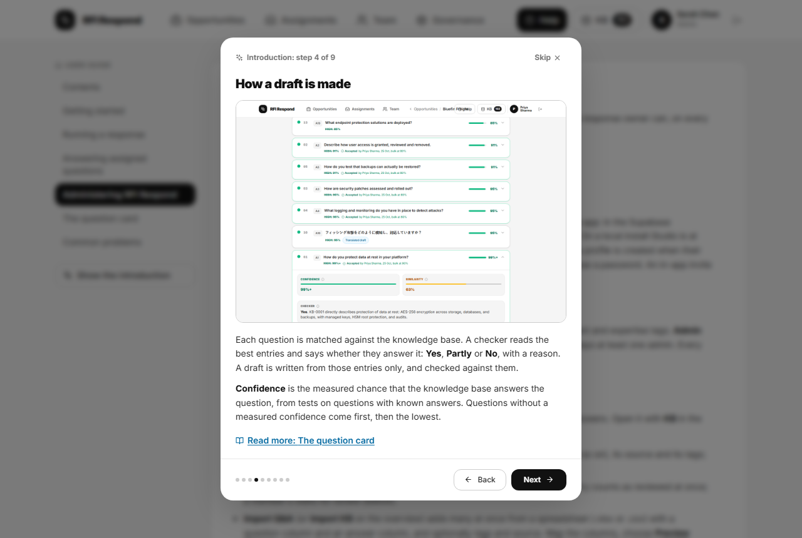
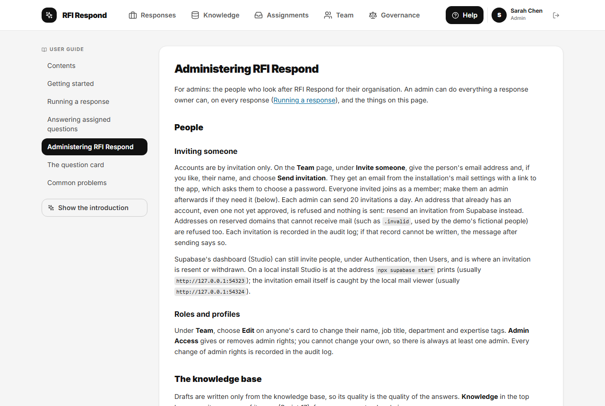

# Getting started

## Signing in

The first time, follow the link in your invitation email: the app asks you to choose a password (at least 12 characters, with letters and digits). After that, sign in with your email address and password and choose **Sign In**. There is no sign-up: if you do not have an account, ask an admin to invite you.

If you have forgotten your password, choose **Forgot password?**, enter your email address and choose **Send Reset Link**. The email contains a link back to the app, which asks you to choose a new password.

The first time you sign in, a short introduction explains what the app does. You can open it again at any time from **Help**, with **Show the introduction**.

## The screens

The bar at the top of every screen has:

- **Responses**: every response in progress, with its owner, due date and progress. This is where you start.
- **Assignments**: questions colleagues have asked you to answer or check, and the ones you have sent to others.
- **Team**: everyone in your organisation, with their job titles and areas of expertise.
- **Governance** (admins only): spend, limits, and knowledge-base entries waiting for review.
- **Knowledge**: the knowledge base, with the number of entries. Open it to search entries, add one, or import a spreadsheet of questions and answers. Entries can be in English or Japanese; matching is by meaning, so a question can match an entry in the other language.
- **Help**: this guide, and the introduction.
- Your name, and **Sign out** (the arrow icon).

On a narrow window some of these show as icons only; hover over an icon to see its name. On a phone-sized screen they are in the menu (the three lines at the top right).

## The overview

**Responses** lists the responses in progress (**Active**) and finished ones (**Archived**). Each card shows:

- the response's name, its owner and its stage: **No questions yet**, **In progress** (questions still to do), **Ready to send** (every question decided), **Exported**, **Changed since export** (an answer changed after the export was recorded), or **Archived** with its outcome;
- how many of its questions are decided, and how many pricing or legal questions are still open;
- the due date, and **Overdue** or **At risk** when it needs attention: at risk means three working days or fewer left with less than 80% of questions decided (or none uploaded yet), or a day or less left with pricing or legal questions still open;
- how many assignments to colleagues are still open (**with experts**). An owner or admin counts them all; anyone else counts only their own.

The tiles at the top count the responses **In progress**, **Ready to send**, **At risk** and **Overdue**; choose one to filter the list. You can also filter by stage, show **Mine only**, or search by name.

Choose a card to open the response.

## Your profile

Under **Team**, choose **Edit** on your own card to change your display name, job title, department and areas of expertise. Expertise tags help owners find the right person for a question (see [Running a response](running-a-response.md#asking-a-colleague)).

## Next

- To answer a questionnaire, read [Running a response](running-a-response.md).
- If a colleague has sent you a question, read [Answering assigned questions](specialists.md).
- If you look after RFI Respond for your organisation, read [Administering RFI Respond](admin.md).
