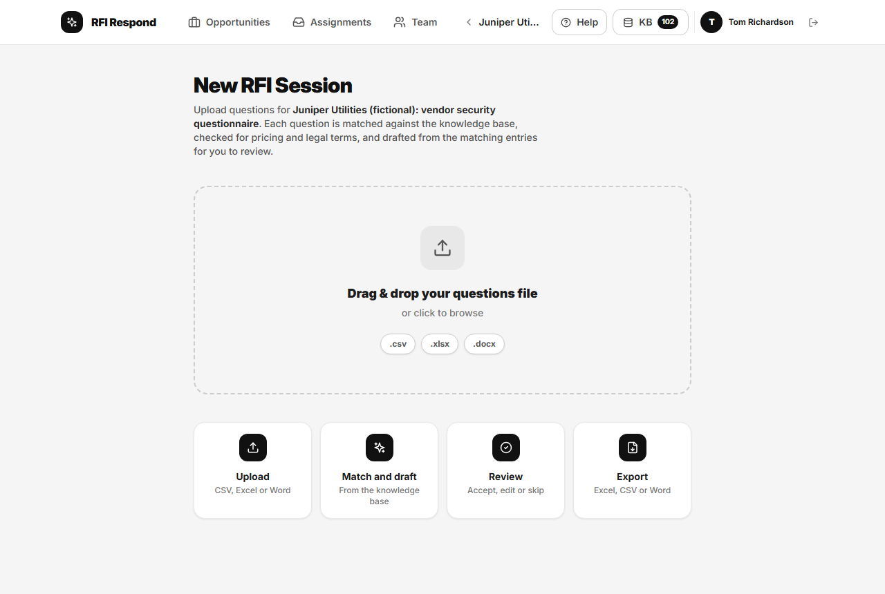
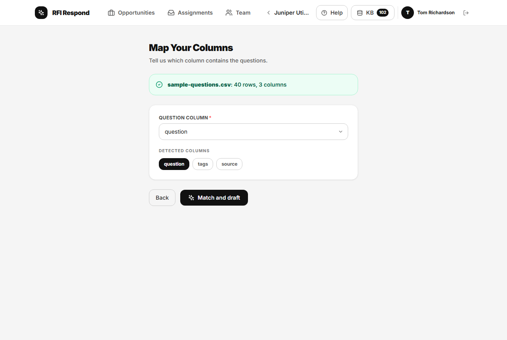
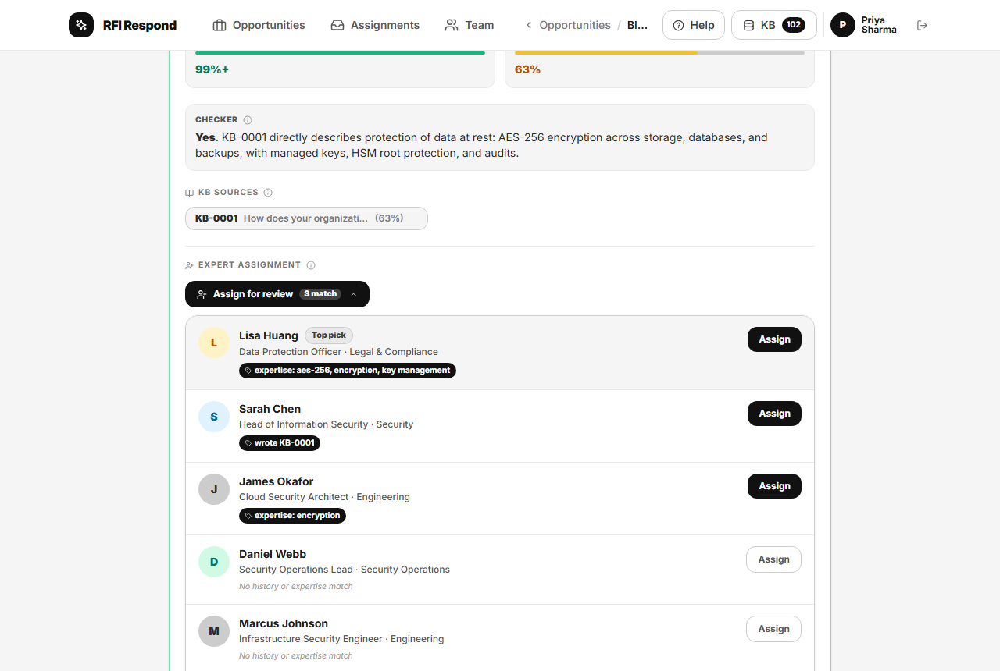

# Running a response

For the person who owns a response: from the customer's questionnaire to answers you can send. An admin can do everything here on any response.

## 1. Start the response

On **Opportunities**, choose **New Opportunity**, give it a name (for example the customer and the questionnaire) and, if you know it, a due date, then **Create**. You become its owner and its workspace opens.

You can rename it or change the due date later from its card on the overview.

## 2. Upload the questions

In the workspace (**New RFI Session**), drop the customer's file on the upload area or click it to choose one:

- A spreadsheet (.xlsx or .csv) with one question per row. Up to 5 MB, 2,000 rows and 5,000 characters in a cell. The older Excel format (.xls) is not accepted.
- A Word questionnaire (.docx). Up to 5 MB. An older Word file (.doc) must be saved as .docx first, and files with macros (.docm) are refused.

Files are opened in your browser with limits on their size and content; nothing in them is run.

### A spreadsheet: choose the question column

**Map Your Columns** shows the columns it found and picks the one that looks like the questions. Change it if it is wrong (the drop-down, or a name under **Detected columns**), then choose **Match and draft**.

### A Word document: check the questions

For a Word document the app finds the questions for you: the text is sent to the server, where a language model (Claude) proposes them, and each is kept only if it appears in the document word for word, with the customer's own numbering. If the AI service is unavailable, simple rules are used instead and the screen says so; check the list more carefully then, as rules can miss questions.

**Check the questions** shows the list before anything is saved. You can edit a question, remove it, add one, or join the parts of a question that was split (**Join the parts into one question**); **Where it came from** shows the passage it was found in. Then choose **Save and match**.

## 3. Matching and drafting

Each question is processed on the server, in batches of ten (**Matching and drafting**):

1. Any knowledge-base entries not yet indexed are indexed first, as far as your daily limit allows; then the question is matched by meaning against the knowledge base.
2. A checker (Claude) reads the best entries and says whether they answer the question: yes, partly or no, with a one-sentence reason.
3. It is checked for pricing and legal content. A draft written across languages (an English question from Japanese entries, or the other way round) is marked as translated, and every Japanese question is reviewed one at a time.
4. Unless nothing close enough was found, a draft is written from the matched entries only, citing them; the drafting model writes none if the entries do not answer the question. Code then rejects a draft that cites an entry it was not given, or contains a figure, link or email address that is not in its sources; the question is left without a draft, with a note saying why.
5. Pricing questions, and questions the knowledge base does not answer, get no draft: a person writes those. [The question card](question-card.md#when-there-is-no-draft) lists the reasons.

Each question gets a calibrated confidence when one can be measured: the measured chance, on a test set, that the knowledge base answers it with the top entry.

Processing stops if you reach your daily limit, or the organisation reaches its monthly budget; the screen says which. Questions that could not be processed stay in the list marked **Not processed yet**, with **Process now** to try again.

## 4. Review

The questions are listed with those without a calibrated confidence first, then lowest confidence first, so the ones most likely to need you come first. Filter them by status (pending, accepted, skipped), by confidence (**High ≥80%**, **Medium 40–80%**, **Low <40%**, and **Not calibrated** when there are any), or search them.

Choose a question to open its card: the checker's verdict and reason, the entries the draft came from (**KB Sources**; choose one to read it in full), the draft, and how it was produced. [The question card](question-card.md) explains every label.

### Deciding one question

- **Accept** approves the draft as it is.
- **Edit First** opens it for editing; **Save & Accept** approves your version.
- **Write an answer** appears instead when there is no draft: write the answer, then **Save & Accept**. A question with no draft cannot be accepted until someone has written its answer.
- **Skip** leaves it unanswered (it is exported as "Not answered"); **Restore** brings it back.
- **Revise Answer** changes an accepted answer; **Save & Accept** records the revised answer as a new acceptance.

Every acceptance records who made it, when, and how (one at a time or in bulk), and every skip who made it and when; the export carries both.

### Approving in bulk

The bulk bar approves every pending draft at or above a confidence in one step: **High ≥80%**, **Medium ≥60%**, or **All eligible**. Only the owner or an admin can use it, and the database decides what it includes. It never includes a question that is:

- pricing, legal, translated or Japanese, or matched while some entries were not yet indexed;
- not fully checked (the classifier or the review check could not run);
- citing a knowledge-base entry that is unreviewed, overdue for review, or replaced;
- judged only partly answered, or not answered, by the checker, or not checked by a checker at all;
- without calibrated confidence, or without a draft.

The bar says how many are held, and why in general; each card says why for that question. They must be accepted one at a time. After a bulk approval a message says how many were accepted and why the rest were held.

## Asking a colleague

When a question needs a specialist, open its card and under **Expert Assignment** choose **Assign for review**. People are suggested from who wrote or approved similar answers before and from the expertise on their profiles, with the reasons shown; **Top pick** marks the strongest suggestion. Choose **Assign** beside a name. You can assign more than one person, and remove someone who has not yet approved it.

The question appears in their **Assignments** inbox ([Answering assigned questions](specialists.md)). Anyone assigned can decide the question in this workspace. When a colleague adds notes, a banner at the top of the review list says how many assignments have notes to review; choose one to go to its question.

## 5. Record the export

When every question is accepted or skipped, choose **Record export** on the bulk bar. Until then it is greyed out; hover over it to see how many are still pending. Recording the export:

- marks the response as exported;
- closes its open assignments;
- lets the knowledge base learn from it (below).

Then download the answers: **Excel (.xlsx)**, **CSV (.csv)** or **Word (.doc)**. Each file records how every answer was produced (drafted by a model, edited, or written by a person, with the model and prompt version) and who approved it, when and how: on a Provenance sheet in Excel, at the end of the Word file, and in columns in CSV. Skipped questions are exported as "Not answered", the reference list at the end of a draft is left out of the exported answer, and the customer's own question numbers are kept.

The app never sends anything to the customer: you send the files.

### Changing an answer after the export

If you find a mistake after recording the export, you can still change an answer or a decision; the owner, an admin or the person the question is assigned to can. The change reopens the export: it is recorded in the audit log with who made it, the response shows **Changed since export** on the overview, and the workspace says the files already downloaded no longer match. Accept the changed answer, then choose **Record export** again and download the answers again. Only the changed answers are learned the second time: an admin's correction replaces the entry learned before, and anyone else's waits beside it for an admin's review.

### What the knowledge base learns

Recording the export turns edited and person-written answers into knowledge-base entries, linked to this response. The panel says what happened to each kind of answer. In short:

- an answer that matches an existing entry closely replaces it, keeping the old one on record;
- otherwise it is added as a new entry;
- a draft accepted unedited confirms the entries it cited, so their review date moves on;
- a member's answer that would replace an entry, or a member's new entry, waits for an admin's review;
- Japanese answers are learned like English ones, and an answer only ever replaces an entry in its own language;
- an answer accepted from a translated draft, edited or not, is learned as a new entry that names the entries it was translated from, and waits for an admin's review even when an admin approved it: approving an answer to send is not the same as approving a translation for every future response;
- pricing answers and unchecked questions are never learned.

## 6. Finish

Choose **New upload** (or **Start New RFI** after the export) to add another file to the same response; earlier files stay under **Previous Sessions** (the ten most recent are listed), where **Resume** or **View** reopens them. The workspace opens on the most recent file.

When the outcome is known, archive the response from its card on the overview: choose the archive icon (**Archive with outcome**), then **Won**, **Lost** or **Withdrawn**, and **Archive**. Won and lost need the export recorded first, and recorded again after any change; a response never sent can only be withdrawn. An archived response is kept as a record and can no longer be changed.

A response created by mistake can be deleted by an admin (see [Administering RFI Respond](admin.md)).
