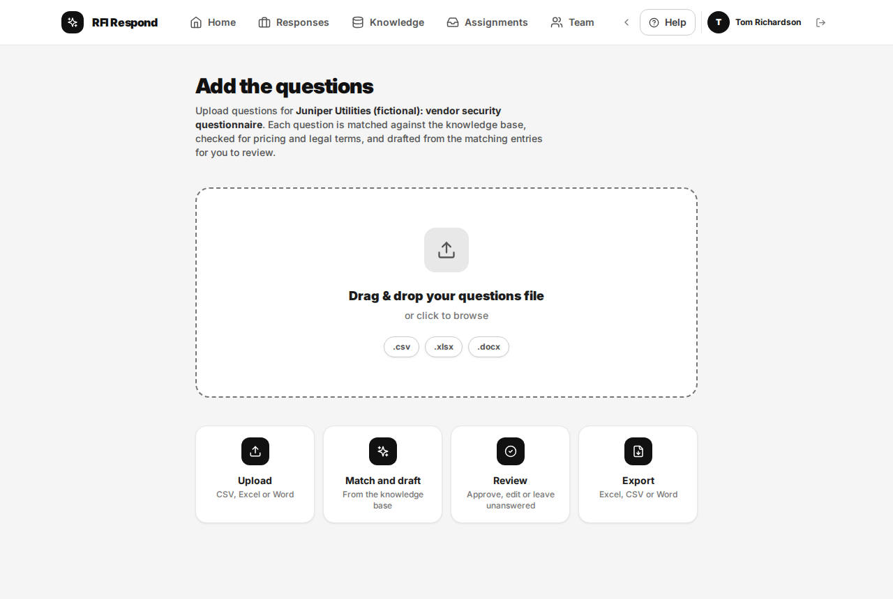
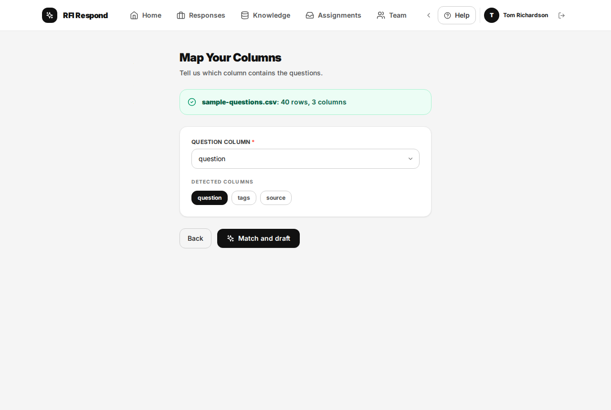
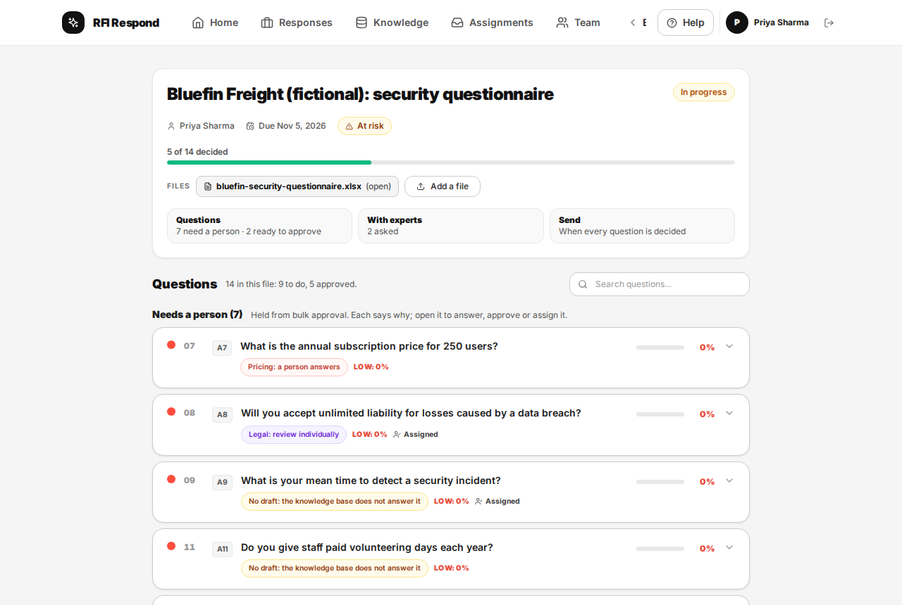
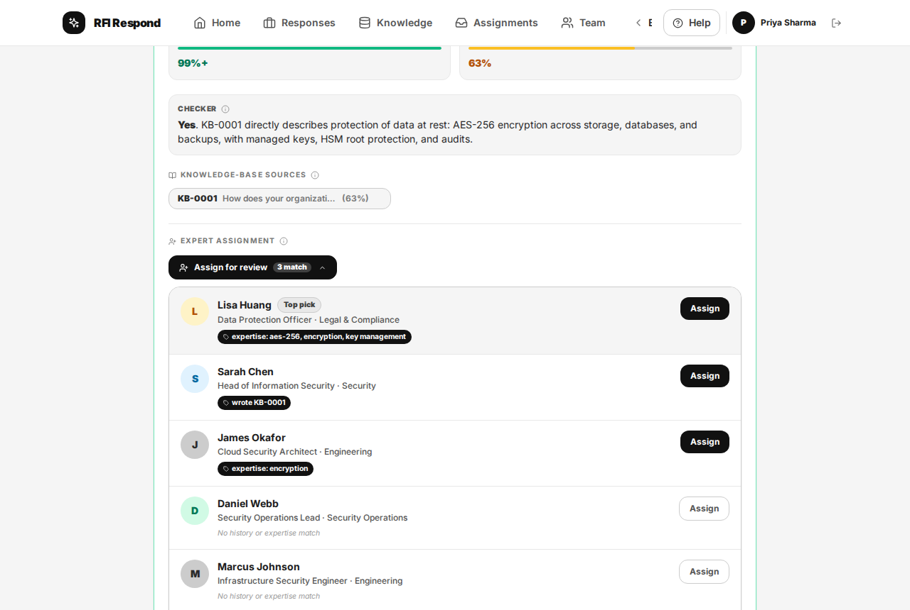
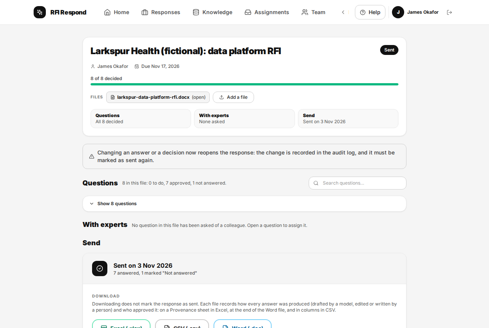

# Running a response

For the person who owns a response: from the customer's questionnaire to answers you can send. An admin can do everything here on any response.

## 1. Start the response

On **Responses**, choose **New response**, give it a name (for example the customer and the questionnaire) and, if you know it, a due date, then **Create**. You become its owner and the response opens.

You can rename it or change the due date later from its card on the overview.

## 2. Upload the questions

Under **Add the questions**, drop the customer's file on the upload area or click it to choose one:

- A spreadsheet (.xlsx or .csv) with one question per row. Up to 5 MB, 2,000 rows and 5,000 characters in a cell. The older Excel format (.xls) cannot be used.
- A Word questionnaire (.docx). Up to 5 MB. An older Word file (.doc) must be saved as .docx first, and files with macros (.docm) are refused.

Files are opened in your browser with limits on their size and content; nothing in them is run.

### A spreadsheet: choose the question column

**Map Your Columns** shows the columns it found and picks the one that looks like the questions. Change it if it is wrong (the drop-down, or a name under **Detected columns**), then choose **Match and draft**.

### A Word document: check the questions

For a Word document the app finds the questions for you: the text is sent to the server, where a language model (Claude) proposes them, and each is kept only if it appears in the document word for word, with the customer's own numbering. If the AI service is unavailable, simple rules are used instead and the screen says so; check the list more carefully then, as rules can miss questions.

**Check the questions** shows the list before anything is saved. You can edit a question, remove it, add one, or join the parts of a question that was split (**Join the parts into one question**); **Where it came from** shows the passage it was found in. Then choose **Save and match**.

## 3. Matching and drafting

Each question is processed on the server, in batches of ten (**Matching and drafting**):

1. Any knowledge-base entries not yet indexed are indexed first, as far as your daily limit allows; then the question is matched by meaning against the knowledge base.
2. A checker (Claude) reads the best entries and says whether they answer the question: yes, partly or no, with a one-sentence reason.
3. It is checked for pricing and legal content. A draft written across languages (an English question from Japanese entries, or the other way round) is marked as translated, and every Japanese question is reviewed one at a time.
4. Unless nothing close enough was found, a draft is written from the matched entries only, citing them; the drafting model writes none if the entries do not answer the question. Code then rejects a draft that cites an entry it was not given, or contains a figure, link or email address that is not in its sources; the question is left without a draft, with a note saying why.
5. Pricing questions, and questions the knowledge base does not answer, get no draft: a person writes those. [The question card](question-card.md#when-there-is-no-draft) lists the reasons.

Each question gets a calibrated confidence when one can be measured: the measured chance, on a test set, that the knowledge base answers it with the top entry.

Processing stops if you reach your daily limit, or the organisation reaches its monthly budget; the screen says which. Questions that could not be processed stay in the list marked **Not processed yet**, with **Process now** to try again.

## 4. Review

A response opens with its header, in the words of its card on **Responses**: the name, the owner, the due date (with **Overdue** or **At risk** when it is), how many of its questions are decided, its stage, and its files. Below the header are three stages, each saying what it holds; choose one to go to it:

- **Questions**: every question in the response, from all its files, grouped by what they need. When a response has more than one file, each card says which file it came from, and the files in the header filter the list: choose a file to see only its questions, or **All files** to see them all again.
- **With experts**: the questions asked of colleagues ([Asking a colleague](#asking-a-colleague)).
- **Send**: downloading the answers and marking the response as sent ([Download and mark as sent](#5-download-and-mark-as-sent)).

Under **Questions**, every question is in one group:

- **Needs a person**: still to do, and never approved in bulk. Each card shows one reason first, such as **Pricing: a person answers**, **No draft: the knowledge base does not answer it** or **The checker found it partly answered**. [The question card](question-card.md#why-a-question-is-reviewed-one-at-a-time) lists them all.
- **Ready to approve**: still to do, and nothing the page knows of holds them from bulk approval, the most confident first, with the bulk bar. Bulk approval checks each one's cited entries again when you use it, so one whose entry has since fallen overdue or been retired is held, and says so.
- **Approved** and **Not answered**: decided. While any question is still to do these are folded; choose one to open it. A question you have open stays in view when you decide it.

**Search questions** finds a question by its text or answer, in every group.

Choose a question to open its card: the checker's verdict and reason, the entries the draft came from (**Knowledge-base sources**; choose one to read it in full), the draft, and how it was produced. [The question card](question-card.md) explains every label.

### Deciding one question

- **Approve** approves the draft as it is.
- **Edit First** opens it for editing; **Save & approve** approves your version.
- **Write an answer** appears instead when there is no draft: write the answer, then **Save & approve**. A question with no draft cannot be approved until someone has written its answer.
- **Leave unanswered** leaves it unanswered (it is exported as "Not answered"); **Restore** brings it back.
- **Revise Answer** changes an approved answer; **Save & approve** records the revised answer as a new approval.

Every approval records who made it, when, and how (one at a time or in bulk), and every question left unanswered, who made it and when; the export carries both.

### Approving in bulk

The bulk bar approves every draft still to do at or above a confidence in one step: **High ≥80%**, **Medium ≥60%**, or **All eligible**. Only the owner or an admin can use it, and the database decides what it includes. It never includes a question that is:

- pricing, legal, translated or Japanese, or matched while some entries were not yet indexed;
- not fully checked (the classifier or the review check could not run);
- citing a knowledge-base entry that is unreviewed, overdue for review, or replaced;
- judged only partly answered, or not answered, by the checker, or not checked by a checker at all;
- without calibrated confidence, or without a draft.

The bar says how many are held; each of them, under **Needs a person**, says why. They must be approved one at a time. After a bulk approval a message says how many were approved and why the rest were held.

## Asking a colleague

When a question needs a specialist, open its card and under **Expert Assignment** choose **Assign for review**. People are suggested from who wrote or approved similar answers before and from the expertise on their profiles, with the reasons shown; **Top pick** marks the strongest suggestion. Choose **Assign** beside a name. You can assign more than one person, and remove someone who has not yet approved it.

The question appears under **Questions for you** in their **Assignments** ([Answering assigned questions](specialists.md)). They can approve it themselves, send their answer to you, or hand it back with a note. An answer they send shows on the question's card as "<their name> marked it answered, with this answer:", with **Use their answer**, which puts it in the editor for you to approve; a handed-back question shows their note. **With experts** lists every question of the open file asked of a colleague: who, where it stands (**Asked**, **Working on it**, **Answered**, **Approved** or **Closed**) and their note, those answered first. Choose one to open it at its question.

## 5. Download and mark as sent

When every question is approved or left unanswered, the response shows **Ready to send**, with the downloads and **Mark as sent**. Until then the line under the bulk buttons says how many are still to do. Only the owner and admins see them.

Download the answers whenever you need them: **Excel (.xlsx)**, **CSV (.csv)** or **Word (.doc)**. A response with more than one file has a download for each file, holding only that file's questions, so the customer gets back each questionnaire they sent. Downloading does not mark the response as sent. Each file records how every answer was produced (drafted by a model, edited, or written by a person, with the model and prompt version) and who approved it, when and how: on a Provenance sheet in Excel, at the end of the Word file, and in columns in CSV. Questions left unanswered are exported as "Not answered", and the customer's own question numbers are kept. The translation label the app adds to a draft is left out of the exported answer wherever it is, and so is the reference list at the end of a draft, exactly as the app wrote it; anything a person wrote stays. Instead, each file records which answers were drafted from entries in another language, under **Translation** in the provenance.

The app never sends anything to the customer: you send the files. When you have, choose **Mark as sent**. It is one step for the whole response, every file at once, and is offered only when every question in every file is decided. Before anything happens it says what marking as sent will do, with the numbers for this response:

- record that it was sent, with your name and the time, in the audit log;
- let the knowledge base learn from the answers people edited or wrote (below);
- close the response's open assignments.

Choose **Confirm: mark as sent** to go ahead, or **Cancel** to change nothing. The response then shows **Sent** on the overview. Opened again later, its **Send** stage still says what the knowledge base did with its answers.

### Changing an answer after it was sent

If you find a mistake after marking the response as sent, you can still change an answer or a decision; the owner, an admin or the person the question is assigned to can. The change reopens the response: it is recorded in the audit log with who made it, the response shows **Changed since sent** on the overview, and the response says the files already downloaded no longer match. Approve the changed answer, download the answers again, and choose **Mark as sent** again. Only the changed answers are learned the second time: an admin's correction replaces the entry learned before, and anyone else's waits beside it for an admin's review.

### What the knowledge base learns

Marking a response as sent turns edited and person-written answers into knowledge-base entries, linked to this response. The panel says what happened to each kind of answer. In short:

- an answer that matches an existing entry closely replaces it, keeping the old one on record;
- otherwise it is added as a new entry;
- a draft approved unedited confirms the entries it cited, so their review date moves on;
- a member's answer that would replace an entry, or a member's new entry, waits for an admin's review;
- Japanese answers are learned like English ones, and an answer only ever replaces an entry in its own language;
- an answer approved from a translated draft, or from a draft citing a translation no admin has reviewed yet, edited or not, is learned as a new entry that names the entries it was translated from, and waits for an admin's review even when an admin approved it: approving an answer to send is not the same as approving a translation for every future response;
- pricing answers and unchecked questions are never learned.

## 6. Finish

Choose **Add a file** in the header to add another file to the same response; only the owner or an admin can. Its questions join the list, and the header lists every file. Once the response is marked as sent, no file can be added: it is the record of what was sent, so a later questionnaire is a new response.

When the outcome is known, archive the response from its card on the overview: choose the archive icon (**Archive with outcome**), then **Won**, **Lost** or **Withdrawn**, and **Archive**. Won and lost need the response marked as sent first, and marked again after any change; a response never sent can only be withdrawn. An archived response is kept as a record and can no longer be changed.

A response created by mistake can be deleted by an admin (see [Administering RFI Respond](admin.md)).
